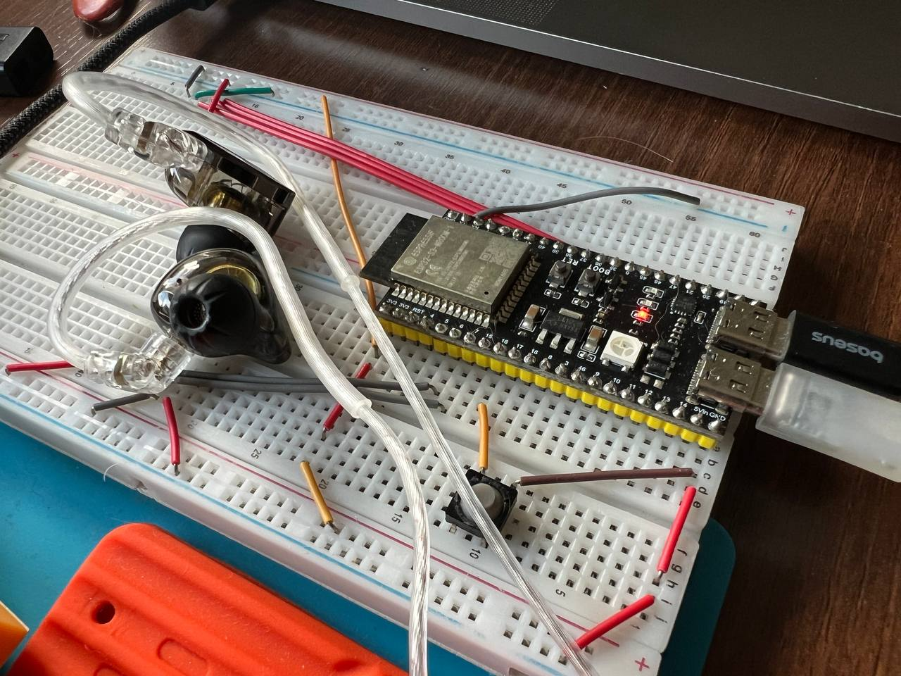

# 📻 esp32-phone

**A pocket internet radio that plays Rádio USP straight into a USB headphone — no PC in the loop.**




> **What you see above:** an **ESP32-S3 dev kit** on a breadboard running this
> firmware. The **USB headphones** (Baseus) plug into the board's **native USB
> port** through a USB-C→USB-A OTG adapter — that port is the USB *host* side,
> and the board powers the headphone through it. The second USB-C cable (UART
> port) powers the board and carries logs/flashing. The extra jumper wires on
> the breadboard are leftovers from earlier experiments — the radio needs none
> of them. 🎧

## 🎵 What it does

```
Wi-Fi ── HTTPS ──► Icecast stream ──► MP3 decoder ──► 44.1k→48k resampler
                                                          │
                            USB headphone ◄── UAC host ◄── PSRAM jitter buffer (~1.4 s)
```

- Joins Wi-Fi, pulls the **Rádio USP 128 kbps MP3** Icecast stream over TLS.
- Decodes it with Espressif's `esp_audio_codec` and resamples 44.1 → 48 kHz
  with a 64-tap Kaiser-windowed-sinc polyphase filter (flat to 20 kHz).
- Buffers ~0.5 s before starting and keeps ~1.4 s of slack, so Wi-Fi jitter
  never causes clicks; the headphone is fed by the **USB Audio Class 1.0**
  host driver at its native 48 kHz / 16-bit stereo.

## 🚀 Build & flash

```sh
cp main/secrets_example.h main/secrets.h   # put your Wi-Fi SSID/password here
. ~/esp/esp-idf/export.sh
idf.py -p /dev/cu.usbmodemXXXX flash monitor
```

Needs **ESP-IDF v5.5+** and an S2/S3/P4 board (those have USB-OTG host).
First build downloads `usb_host_uac`, `usb` and `esp_audio_codec` automatically.

## 📊 Health line

Every 15 s the firmware reports its vitals — a healthy stream looks like this:

```
radio: stats: ring=261108 min=252000 (96%) net=15974B/s dec=16021B/s
              mp3=38.3f/s underruns=0 resyncs=0 drops=0
```

`mp3=38.3f/s` is exactly real-time for 44.1 kHz; `ring` at ~96% means the
jitter buffer is full; `underruns/resyncs/drops` should stay at **0**.

## ⚙️ Gotchas worth knowing

| Area | Detail |
|---|---|
| 🧠 PSRAM | Run at **40 MHz** (`CONFIG_SPIRAM_SPEED_40M=y`). At 80 MHz this board went marginal: boot memtest failures, cache stalls, watchdog reboots. |
| ⚡ CPU | **240 MHz + -O2** (`CONFIG_COMPILER_OPTIMIZATION_PERF=y`). At -Os the resampler loop was ~4× slower and starved the pipeline. |
| 🔌 USB FIFO | `CONFIG_USB_HOST_HW_BUFFER_BIAS_PERIODIC_OUT=y` — isochronous OUT packets need >128 B (ours: 384 B). |
| 🎛️ Decoder | Both `esp_audio_dec_register_default()` **and** `esp_audio_simple_dec_register_default()` are required. Only the MP3 codec is enabled to fit the binary. |
| 📦 Buffering | Playback waits for `PCM_PREBUFFER_BYTES` (0.5 s). The UAC driver halts its isochronous stream when its ring starves, which is audible as clicks — never start dry. |
| 📡 Wi-Fi | `esp_wifi_set_ps(WIFI_PS_NONE)` — modem sleep adds hundreds of ms of jitter. |
| 🧩 Carry-over | The MP3 parser leaves partial frames unconsumed across reads; the leftovers **must** be re-fed, not dropped (dropping them halves the data rate → slow-motion audio). |

<details>
<summary>🔧 Troubleshooting</summary>

| Symptom | Cause / fix |
|---|---|
| Audio slow / half speed | Check stats: `mp3=` should be ~38 f/s; if not, the pipeline is starving |
| Nothing after "UAC host driver installed" | Headphone has no power — some boards don't output 5 V on the OTG port; power it externally (VBUS/GND) or use a powered hub |
| `EP MPS (...) exceeds supported limit (128)` | FIFO bias fix missing (see above) |
| `External RAM failed memory test!` | PSRAM timing marginal — keep 40 MHz |
| Random reboots / interrupt watchdog | Same as above |
| Clicks and dropouts | Increase `PCM_RING_BYTES` / `PCM_PREBUFFER_BYTES`, check `underruns` |
| UAC 2.0-only device (Apple dongle) | This driver is UAC 1.0 only |

</details>

## 📁 Layout

```
main/main.c            Wi-Fi + HTTP stream + MP3 decode + resample + UAC
main/secrets.h         your Wi-Fi credentials (gitignored)
docs/rig.jpg           the photo above
partitions.csv         8 MB factory app on 16 MB flash
sdkconfig.defaults     PSRAM 40 MHz, 240 MHz, -O2, FIFO bias, codec trim
tools/monitor.py       dependency-free serial log capture
```

## 🌱 Next ideas

Mic loopback (it already sees the headphone's UAC input interface) · volume/station
buttons · a tiny web UI · an actual SIP/WebRTC "phone" on the same pipeline.

---

*SPDX-License-Identifier: Apache-2.0*
